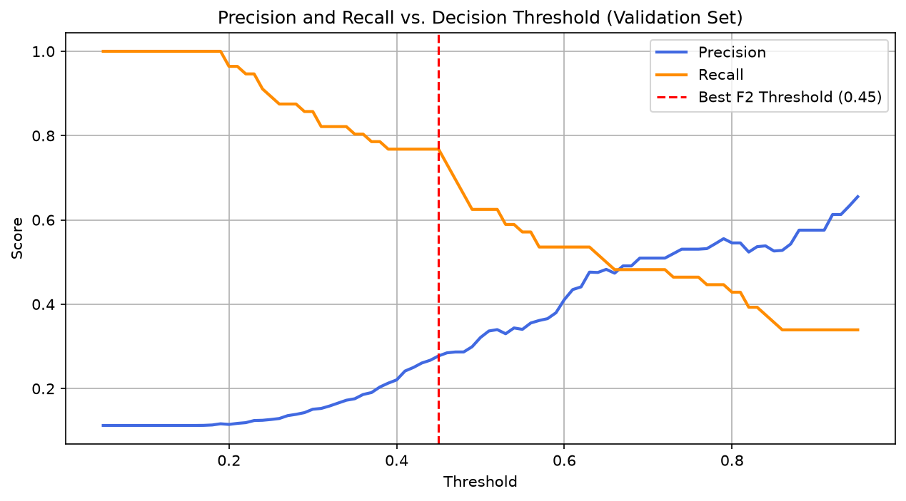

# Nifty 50 volatility spike warning

A machine learning classifier that predicts, at the end of each trading day, whether the **next** trading day will see an unusually large move in the Nifty 50 index. It is built as an early-warning tool for beginner traders.

> Educational project. Not financial advice.

**Live app:** _add your Streamlit link here_

## Problem

Large one-day moves hurt traders who are not expecting them. Volatility tends to cluster, so recent market behaviour carries information about tomorrow. The goal is a model that turns that information into a warning, and an honest check of whether it beats a simple "tomorrow looks like today" rule.

This is a binary classification problem: 1 means a spike tomorrow, 0 means no spike.

## Data

- Source: Yahoo Finance through `yfinance`, ticker `^NSEI`, daily prices.
- Range: 17 Sep 2007 to 30 Oct 2026 (4,691 raw rows).
- Raw file: `data/nifty50_raw.csv`. The download script is `src/download_data.py`.
- Cleaning: removed the two extra header rows, converted dates and prices to proper types.
- Volume is 0 for every day from 2007 to 2012 because no volume source existed, and it has scattered zeros later, so volume is not used.
- After building features and labels, 4,661 rows remain (`data/nifty50_features.csv`).

## Target definition

A day is labelled 1 if the **next** day's absolute return passes either threshold:

1. a fixed threshold: more than 2%
2. a relative threshold: more than 2.5 times the 20-day rolling volatility

The fixed part catches large moves in turbulent markets. The relative part catches surprises in calm markets. About 9.4% of days are positive.

The last row is dropped because tomorrow's return is unknown, and the first 20 rows are dropped because the volatility window is incomplete. Parameters were fixed from class balance and domain reasoning before any modelling, not tuned on model scores.

## Features

All seven features use only data up to and including the day itself.

| Feature | Meaning |
|---|---|
| `feat_sma_return_5` | Average daily return over 5 days |
| `feat_daily_range` | (High - Low) / Close for the day |
| `feat_ema_ratio_5` | Close divided by its 5-day exponential average |
| `feat_max_return_10` | Best daily return in the last 10 days |
| `feat_min_return_10` | Worst daily return in the last 10 days |
| `feat_vol_ratio` | 5-day volatility divided by 20-day volatility |
| `vol_20` | 20-day rolling standard deviation of returns |

A 5-day rate-of-change feature was dropped because it was almost identical to the 5-day average return (correlation 0.9995).

## Method

- **Time-based split, no shuffling:**

  | Part | Years | Rows | Spike rate |
  |---|---|---|---|
  | Train | up to 2019 | 2,972 | 10.90% |
  | Validation | 2020-2021 | 498 | 11.24% |
  | Test | 2022 onward | 1,191 | 4.87% |

- **No leakage:** the scaler is fitted on training data only, inside a scikit-learn pipeline.
- **Baselines:** an always-0 model and a persistence rule (warn when `vol_20` is above the training 90th percentile).
- **Models:** logistic regression (scaled, balanced class weights) and a random forest (depth 6, at least 20 samples per leaf, balanced subsample weights).
- **Threshold tuning:** F2 score (recall weighted higher than precision), chosen on the validation set only, then applied unchanged to the test set.
- **Headline metric:** PR-AUC, because spikes are rare and it does not depend on a threshold.
- **Final model:** logistic regression, chosen on validation results and because its coefficients explain each warning.

## Results

Test set (2022 onward, 58 spikes in 1,191 days):

| Model | Accuracy | Precision | Recall | F1 | PR-AUC |
|---|---|---|---|---|---|
| Always predict 0 | 0.951 | 0.000 | 0.000 | 0.000 | 0.049 |
| Persistence rule | 0.951 | 0.000 | 0.000 | 0.000 | 0.077 |
| Logistic regression, threshold 0.50 | 0.904 | 0.167 | 0.241 | 0.197 | 0.159 |
| Random forest, threshold 0.50 | 0.919 | 0.172 | 0.172 | 0.172 | 0.145 |
| Logistic regression, tuned threshold 0.45 | 0.876 | 0.143 | 0.310 | 0.196 | 0.159 |
| Random forest, tuned threshold 0.45 | 0.904 | 0.174 | 0.259 | 0.208 | 0.145 |

Validation PR-AUC: persistence 0.372, logistic regression 0.505, random forest 0.519.

The final model, logistic regression at threshold 0.45, caught 18 of 58 test spikes and raised 108 false alarms.



## Findings

- Volatility clusters. The biggest spikes sit in 2008-09 and 2020, and spikes tend to follow recent price declines.
- Accuracy is misleading here. Always predicting 0 scores 95% accuracy and catches nothing.
- The persistence rule worked on 2020-2021 but never fired on the test period. Test volatility never reached the level learned in training (maximum 0.0189 against a cutoff of 0.0204). This is a regime shift.
- Both models score about three times chance on the test PR-AUC. That is better than the baselines, but modest in absolute terms.
- Logistic regression and the random forest performed about the same, so the simpler, more interpretable model was kept.
- `vol_20` carries the largest logistic coefficient, so much of the signal is still volatility persistence. Correlated features (for example `feat_max_return_10` and `vol_20`, correlation 0.80) make individual coefficient signs unreliable.
- Train and validation PR-AUC were similar for the forest, while test was much lower. That points to a regime and base-rate shift, not overfitting.

## Limitations

- Only 58 spikes in the test period, so differences between models are within noise.
- Thresholds and labels involve judgement calls (2% and 2.5 times volatility).
- The risk score is a ranking, not a calibrated probability, because of class weights.
- The threshold was tuned on 2020-2021, a crash period, and produces many false alarms in calmer markets.
- Uses only Nifty 50 price data.

## Future work

- Gradient boosting and time-series cross-validation
- More inputs: India VIX, global indices, event calendars
- Predicting the size of the move (regression) as well as whether a spike happens
- Calibrated probabilities and periodic retraining

## How to run

```bash
python -m venv venv
venv\Scripts\activate          # Windows
pip install -r requirements.txt
streamlit run app.py
```

To reproduce the results, run `notebooks/01.EDA.ipynb` and then `notebooks/02.Modelling.ipynb`. Do not rerun `src/download_data.py` unless you want fresh data, because new rows change every result.

## Project structure

```
vol-spike-alert/
  app.py                    Streamlit app
  data/                     raw and feature data
  images/                   saved figures
  models/                   trained pipeline, config, results table
  notebooks/                EDA and modelling notebooks
  src/                      data download script
  requirements.txt
```

## AI assistance

_Write this section to match your instructor's disclosure rules._

## Disclaimer

For education only. Nothing here is financial advice, and the model should not be used to make trading decisions.